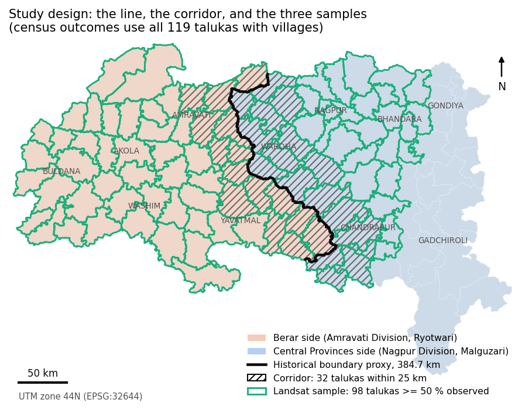
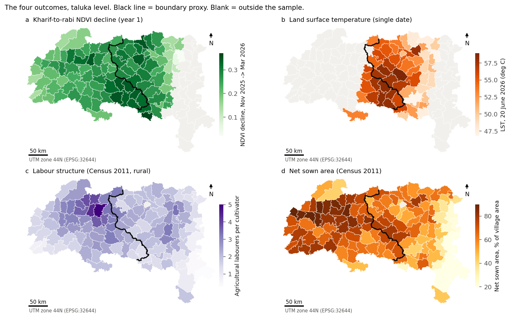
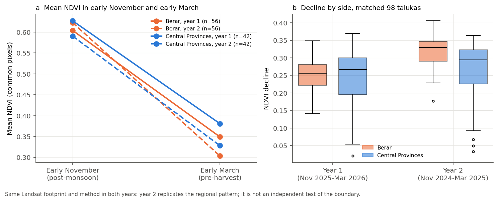
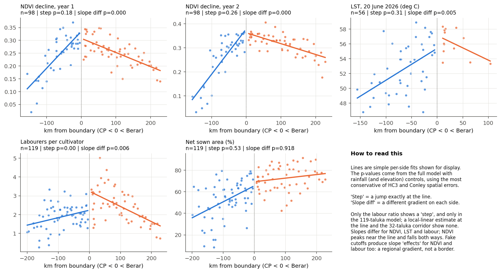
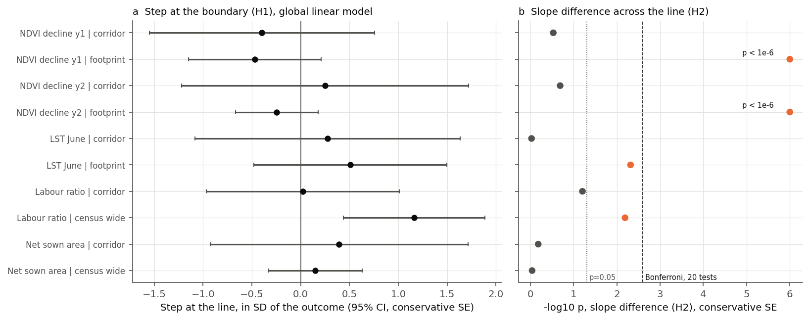
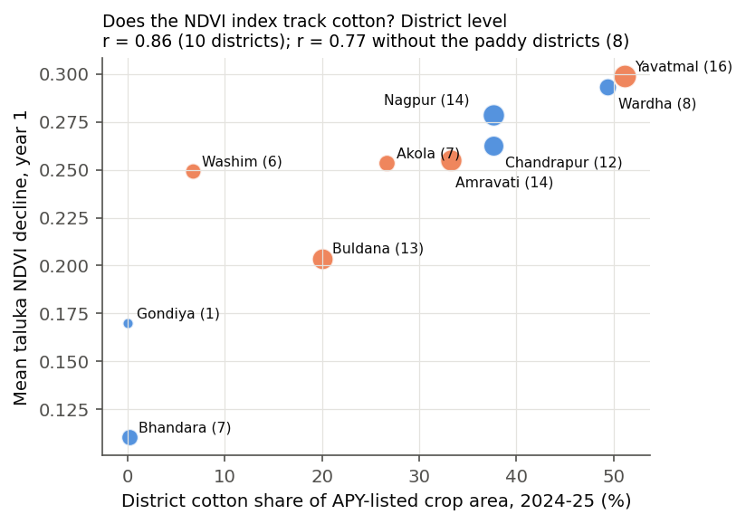
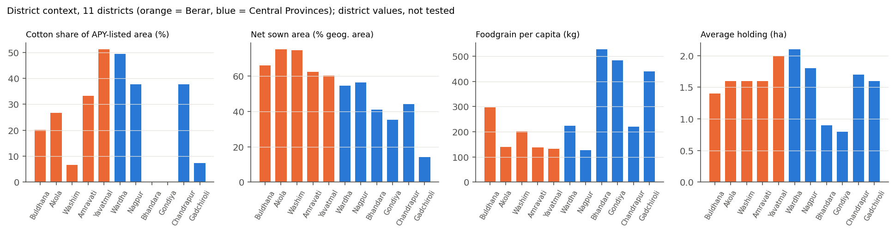
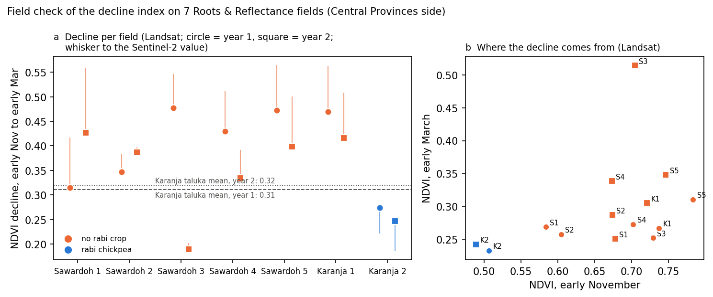

# The Cotton Line: Is an Erased Colonial Land-Revenue Boundary Still Visible in Vidarbha's Satellite and Census Record?

**Sakshi D. Maske**
Independent Geospatial Researcher

*Version 2.1, October 2026. This version replaces the September 2026 draft. Every number below is produced by `05_Python/run_all.py --full` (30 m masked NDVI over Landsat paths 144–146).*

## Abstract

Can a provincial boundary abolished in 1956 still be detected in today's farmland? In the nineteenth century Berar, in western Vidarbha, was settled under the Ryotwari land-revenue system. The Central Provinces districts to the east were settled under Malguzari. On district lineage the old line matches the present boundary between Amravati and Nagpur Divisions, which I rebuild as a 384.7 km line from 120 talukas.

I test two hypotheses at that line: a level step (H1) and a change of slope (H2). The tests use four present-day outcomes:
- a satellite cropping-intensity index (the fall in Landsat NDVI from November to March, measured in two years);
- land surface temperature (LST) on one June date;
- the 2011 ratio of agricultural labourers to cultivators;
- the 2011 share of net sown area.

The model is a spatial-discontinuity regression with rainfall and elevation controls. It is run on a 32-taluka corridor, on the talukas the Landsat scenes observe (98 for NDVI, 56 for LST), and on all 119 census talukas. NDVI is computed at 30 m with cloud, shadow and cropland masks. Inference uses the most conservative of heteroskedasticity-robust and Conley spatial standard errors, with Holm correction over 20 tests.

**Findings.**
- **No level step (H1).** No outcome shows a step at the line in the corridor, in the Landsat sample, or in local-linear estimates at the line.
- **One exception, which is not local.** In the 119-taluka census model, labour structure differs across the line (+0.96 labourers per cultivator on the Berar side; Holm p = 0.029). The difference is absent within 60 km of the line and in local-linear estimates, so it is regional rather than a step at the boundary.
- **The NDVI pattern is a ridge, not a step.** The cropping-intensity index is highest within 50 km of the line on both sides (0.29) and falls away towards Buldhana in the west (0.21) and the paddy districts in the east (0.13). The raw gap between the sides is small and unstable: 0.009 in year 1, 0.057 in year 2.
- **Slopes do differ (H2).** The gradient changes across the line for NDVI decline in both years (Holm p < 0.001) and, before correction, for LST and labour. For NDVI this is the crest of the ridge.
- **Fake boundaries do the same.** Placebo cutoffs inside each side reproduce the NDVI and labour slope changes. Only the LST pattern passes that test, and it is a single pre-monsoon date.

**Validation and conclusion.** At district level the NDVI index tracks the official cotton share (r = 0.86 for 10 districts; 0.77 without the two paddy districts), so it measures a real agricultural pattern. The cotton core of Vidarbha straddles the old line rather than stopping at it. The evidence shows no discontinuity at the line, and it cannot attribute anything to land tenure.

**Keywords:** spatial discontinuity, boundary persistence, historical GIS, Landsat, NDVI, land surface temperature, Conley standard errors, Vidarbha, Ryotwari, Malguzari

---

## 1. Introduction

Vidarbha's farm distress is usually explained by rainfall, prices and crop choice. A longer explanation points to history. Berar was assigned to the East India Company by the Nizam of Hyderabad in 1853, leased to Britain in perpetuity in 1902 and merged with the Central Provinces in 1903. It was settled under the Ryotwari system, in which each cultivator held a plot and paid revenue directly to the state. The Nagpur territories to the east, annexed in 1853–54, were settled under Malguzari, in which a village revenue-holder (the malguzar) answered for the whole village (Baden-Powell, 1892). Cotton expanded rapidly in Berar from the 1860s (Satya, 1997; Beckert, 2014).

The two provinces became one administration in 1903, and the provincial line disappeared in the 1956 reorganisation of states. On district lineage, the present boundary between Amravati Division and Nagpur Division follows it.

That boundary is also older than British rule. The Wardha river formed much of the frontier between the Nizam's Berar and the Bhonsle kingdom of Nagpur, and the line runs along a transition in rainfall, soils and cropping. Any difference found at the line could therefore come from tenure, from earlier political history, or from physical geography. This paper does not try to separate them. It asks the narrower question that comes first.

**Research question.** After controlling for rainfall, elevation and distance to the line, is the former Berar/Central Provinces boundary detectable as a spatial discontinuity in present-day satellite and census indicators of agriculture?

- **H1 (level step).** The outcome jumps at the line: the `side` coefficient is non-zero.
- **H2 (slope change).** The outcome changes with distance differently on the two sides: the `side × distance` coefficient is non-zero.

A finding for H1 would show that the line still marks a sharp difference. A finding for H2 alone, especially one that also appears at placebo lines, describes a regional gradient and not a boundary.

**Contribution.** The paper offers three things:
- a reproducible construction of a historical boundary proxy and of taluka-level satellite and census indicators;
- a test of that boundary with spatially robust inference, placebo lines, local estimates and an explicit statement of statistical power;
- a demonstration that a regional cropping pattern visible from space can look like a boundary effect until the whole region is observed and the line is tested properly.

## 2. Background and related work

**Colonial land tenure and persistence.** Banerjee and Iyer (2005) found that Indian districts settled under landlord-based revenue systems had lower agricultural investment and productivity after Independence than districts settled with cultivators. Iversen, Palmer-Jones and Sen (2013) showed that Banerjee and Iyer coded most Central Provinces districts as landlord districts, although Malguzari settlement included cadastral surveys and statutory tenant protection. After recoding the Central Provinces, they find no evidence that landlord tenure lowered post-Independence agricultural performance. I follow the corrected reading and treat Malguzari as a category of its own. Iyer (2010) compares directly and indirectly ruled areas of British India, and Dell and Olken (2020) study long-run effects around colonial sugar factories in Java.

**Boundaries as discontinuities.** Dell (2010) estimates the effect of Peru's colonial mining *mita* with distance to its boundary as the running variable. Keele and Titiunik (2015) set out when a geographic boundary can be treated as a regression discontinuity. They also warn that natural geography often changes at the same line, which is the central problem here. Kelly (2019) shows that persistence regressions on spatial data often overstate precision because of spatial autocorrelation; spatial-HAC errors (Conley, 1999) are the standard remedy. Lee and Lemieux (2010) recommend local estimates and bandwidth checks.

**Seeing cropping from orbit.** NDVI (Tucker, 1979) contrasts red light, which chlorophyll absorbs, with near-infrared light, which leaf structure scatters. The fall in NDVI from early November to early March measures how much green cover is lost between the end of the monsoon season and late winter. Under a single long-duration crop that is picked and then left fallow, the fall is large. Where a second (rabi) crop, irrigation or perennial cover follows, it is small.

This is a **cropping-intensity index, not a cotton detector**: soybean is harvested before November and rice in the east may still stand. Section 4.5 checks the index against official cotton statistics.

LST from Landsat's thermal band is physically linked to NDVI, because bare soil heats faster than transpiring canopy. In the pre-monsoon season, however, it mostly measures soil and surface type.

## 3. Data and methods

### 3.1 Units, boundary and samples

The unit is the taluka (sub-district): 120 talukas in Vidarbha's 11 districts, from the Census 2011 / Local Government Directory sub-district layer.

**Building the line.** Talukas are dissolved into Amravati Division (Berar; 56 talukas) and Nagpur Division (Central Provinces; 64 talukas), and the shared edge is merged into a single line of 384.7 km.

**Distances.** Distances are measured from each taluka centroid to the line in UTM zone 44N. `signed_dist_km` is positive on the Berar side.

The line is a proxy. District lineage from 1903 to 1956 maps the historical Berar districts onto today's Amravati Division and the Central Provinces districts onto today's Nagpur Division. This is district-level evidence, not a geometric match with a period map. Some Central Provinces-side talukas came from other jurisdictions; Rajura, for example, came from Hyderabad State. Section 4.6 shows that excluding Rajura, Korpana and Jiwati does not change the results.

**Three samples** (Figure 1):

| Sample | Rule | Talukas |
|---|---|---|
| Corridor | taluka polygon intersects a 25 km buffer of the line | 32 (15 Berar, 17 Central Provinces) |
| Landsat sample | at least 50 % of the taluka's cropland observed on both seasonal dates (NDVI); at least 50 % of the taluka observed (LST) | 98 for NDVI in each year (56 Berar, 42 Central Provinces); 56 for LST (13 Berar) |
| Census sample | every taluka with Census 2011 villages | 119 (56 Berar, 63 Central Provinces; Nagpur Urban has no villages) |

These rules were set before the results were examined.

**Landsat coverage.** NDVI uses nine Landsat scenes per date: WRS-2 paths 144, 145 and 146, rows 045 to 047. They touch 103 talukas; 5 have less than half of their cropland observed on both dates and are excluded (Sawali is below 1 %). The NDVI sample therefore contains every Berar taluka (56, reaching 228 km from the line) and 42 Central Provinces talukas (reaching 156 km). Gadchiroli and most of Gondiya lie on path 143, which is not used. LST comes from a single June scene on path 144 and keeps the smaller 56-taluka sample.

**Figure 1.** Study design: the boundary proxy, the 32-taluka corridor (hatched) and the 98 talukas in the NDVI sample (green outline). Census outcomes use all 119 talukas with villages.

### 3.2 Data

| Variable | Source | Notes |
|---|---|---|
| Taluka boundaries | Census 2011 / LGD sub-districts (datta07/INDIAN-SHAPEFILES); IIT Bombay POCRA district shapefiles | 120 talukas |
| NDVI | Landsat 8/9 Collection 2 Level-2 surface reflectance (USGS; via Microsoft Planetary Computer), SR_B4, SR_B5 and QA_PIXEL | Paths 144–146, rows 045–047, one date per path and season. Year 1: 8–15 Nov 2025 → 6–8 Mar 2026. Year 2: 27 Oct–5 Nov 2024 → 11–13 Mar 2025 |
| Cropland mask | ESA WorldCover 2021, 10 m (Zanaga et al., 2022) | Class 40 (cropland) |
| LST | Landsat 8 Collection 2 Level-2 ST_B10 | 20 June 2026, pre-monsoon, single date |
| Labour structure, land use | Census 2011 village attributes (POCRA village shapefiles), aggregated to taluka | All 11 districts; rural villages only |
| Rainfall | WorldClim 2.1 monthly normals, 10 arc-minute grid (Fick & Hijmans, 2017) | Long-term climatology at taluka centroids |
| Elevation | SRTM 1 arc-second (Farr et al., 2007) | At taluka centroids |
| District context | Maharashtra APY 2024-25; Economic Survey of Maharashtra 2025-26 | District level, descriptive only |

### 3.3 Satellite processing

Landsat Level-2 products use digital number 0 as fill for off-swath pixels. An early version of the pipeline scaled these fill pixels instead of masking them, producing a floor of −124.15 °C in the LST mosaic and fake "valid" reflectance in a third of each scene. All rasters were rebuilt with DN = 0 masked before scaling.

**NDVI (30 m, `03b_build_eo_30m_masked.py`).** Each pixel is masked if it is fill (DN = 0), if QA_PIXEL flags dilated cloud, cirrus, cloud, cloud shadow or water, or if ESA WorldCover 2021 does not class it as cropland. Four rules then apply per taluka:
1. **The decline uses common pixels only,** meaning cropland pixels valid on both dates, so the November and March means describe the same fields.
2. **Coverage is counted against the taluka's cropland.** An earlier version divided by the taluka's bounding box, which made fully observed talukas look half-empty (Karanja in Wardha was reported at 45.8 % but is 100 % covered).
3. **Talukas with less than half of their cropland observed are excluded.**
4. **Rows of one path are merged on a shared grid.** Where two paths see the same taluka, the better-covered path is used and the other is kept as a consistency check: across 30 taluka-years seen twice, the two paths differ by 0.036 on average (maximum 0.07), against a regional range of 0.11 to 0.30.

**LST** is summarised from the 300 m block average of the corrected 30 m June scene, with the same polygon-based coverage rule.

### 3.4 Model and inference

For each outcome *y* and sample:

y = β0 + β1·side + β2·signed_dist_km + β3·(side × signed_dist_km) + γ1·rainfall + γ2·elevation + ε

β1 tests H1 (step) and β3 tests H2 (slope change).

**Primary p-value.** Taluka observations are spatially correlated: residual Moran's I is 0.29–0.50 for NDVI, LST and the census outcomes in the larger samples (Table S3). Conley spatial-HAC errors correct for this, but with 25–120 units they can understate uncertainty when residuals are not correlated. The primary p-value is therefore the largest of three: HC3, Conley with a 50 km cutoff, and Conley with a 100 km cutoff. OLS and district-clustered p-values are reported for reference. Clustering is unreliable with 5–11 districts.

**Multiple testing.** There are 20 tests: two coefficients for each of five outcome series (NDVI year 1, NDVI year 2, LST, labour, net sown area) at two scales. Holm and Benjamini–Hochberg corrections are applied to the primary p-values.

**Robustness checks.** In addition to the main model:
- local-linear regression discontinuity with a triangular kernel at 40, 60 and 80 km bandwidths;
- symmetric distance windows (40, 60, 80 and 105 km);
- placebo cutoffs inside each side;
- dropping the most influential taluka (largest Cook's distance);
- excluding Rajura, Korpana and Jiwati;
- coverage thresholds from any-pixel to 90 %;
- the minimum detectable step at 80 % power (MDE = 2.8 × the conservative standard error).

## 4. Results

### 4.1 The regional picture

Figure 2 maps the four outcomes.
- **NDVI decline** is largest in the Yavatmal–Wardha cotton belt and smallest in the paddy and forest districts of Bhandara and Gondiya.
- **LST** is highest along the Wardha valley and lower in the forested east.
- **The labour ratio** is highest in Amravati district.
- **Net sown area** falls steadily from west to east.

**Figure 2.** The four outcomes by taluka. Black line: boundary proxy. Blank: outside that outcome's sample.

**A ridge, not a step.** The NDVI decline is highest close to the line on both sides and falls away in both directions (Figures 3 and 4):

| Distance from the line | Central Provinces side | Berar side |
|---|---|---|
| 0–50 km | 0.292 (18 talukas) | 0.293 (17) |
| 50–100 km | 0.260 (15) | 0.270 (13) |
| 100–150 km | 0.132 (9; all CP talukas beyond 100 km) | 0.238 (13) |
| 150–228 km | — | 0.206 (13) |

Values are year 1. The fall is steep into the paddy and forest belt of Bhandara and Gondiya, and gentler towards Buldhana in the west.

**Side averages.** Because the ridge straddles the line, the averages by side are close:

| | Berar (56) | Central Provinces (42) | Gap |
|---|---|---|---|
| Year 1 NDVI decline | 0.255 | 0.246 | 0.009 |
| Year 2 NDVI decline | 0.319 | 0.262 | 0.057 |

**Second year.** The two years' taluka values correlate at r = 0.84. Both years use the same scenes and method, so year 2 replicates the regional pattern; it is not an independent test of the boundary. The side gap moves between years while the ridge stays, so the ridge, not the gap, is the stable feature.

**Near the line.** In the corridor the sides are almost identical (year 1: 0.294 against 0.290). Once distance to the line is modelled, the Berar–Central Provinces difference at the line is −0.027 (p = 0.09).

**Census outcomes:**

| | Berar | Central Provinces |
|---|---|---|
| Labour ratio, corridor | 2.90 | 1.96 |
| Labour ratio, 119 talukas | 2.46 | 1.89 |
| Net sown area, corridor | 68.9 % | 61.5 % |
| Net sown area, 119 talukas | 72.5 % | 52.6 % |

**Figure 3.** (a) Mean NDVI in early November and early March by side and year, on common cropland pixels, for the 98 talukas valid in both years. (b) Distribution of the decline.

### 4.2 H1: no step at the line

Table 1 reports all 20 tests and Figure 5a shows the step estimates.

**Table 1.** Step (H1) and slope-change (H2) tests. Primary p = largest of HC3, Conley 50 km and Conley 100 km. Holm correction over the 20 primary p-values.

| Outcome | Sample | n (Berar) | Step | p (primary) | Slope change per km | p (OLS) | p (primary) | Holm p (slope) |
|---|---|---|---|---|---|---|---|---|
| NDVI decline, year 1 | Corridor | 32 (15) | −0.015 | 0.50 | −0.0010 | 0.27 | 0.30 | 1.00 |
| NDVI decline, year 1 | Landsat | 98 (56) | −0.030 | 0.18 | −0.0019 | <0.001 | **<0.001** | **<0.001** |
| NDVI decline, year 2 | Corridor | 32 (15) | 0.007 | 0.74 | −0.0013 | 0.096 | 0.21 | 1.00 |
| NDVI decline, year 2 | Landsat | 98 (56) | −0.018 | 0.26 | −0.0023 | <0.001 | **<0.001** | **<0.001** |
| LST, °C | Corridor | 26 (10) | 0.83 | 0.69 | 0.008 | 0.96 | 0.95 | 1.00 |
| LST, °C | Landsat | 56 (13) | 1.77 | 0.31 | −0.077 | 0.025 | **0.005** | 0.083 |
| Labour ratio | Corridor | 32 (15) | 0.02 | 0.97 | 0.037 | 0.036 | 0.063 | 1.00 |
| Labour ratio | Census, 119 | 119 (56) | **0.96** | **0.002** (Holm 0.029) | −0.008 | <0.001 | **0.006** | 0.10 |
| Net sown area, % | Corridor | 32 (15) | 4.83 | 0.56 | −0.17 | 0.65 | 0.66 | 1.00 |
| Net sown area, % | Census, 119 | 119 (56) | 2.72 | 0.53 | −0.006 | 0.88 | 0.92 | 1.00 |

**In the corridor and the Landsat sample, no outcome steps at the line.** Local-linear estimates at 40, 60 and 80 km show no jump for any outcome (all p ≥ 0.16; for NDVI, p ≥ 0.28; Table S4).

**The labour ratio is the exception, and it is not local.** In the 119-taluka model it is higher on the Berar side by 0.96 labourers per cultivator (primary p = 0.002; Holm p = 0.029). That step is:
- zero in the corridor (0.02, p = 0.97);
- not significant within 40 or 60 km of the line;
- significant only once windows reach 80 km;
- absent in local-linear estimates (p = 0.16–0.71).

The labour gap is therefore a regional difference concentrated in Amravati district, where ratios reach 3–5. It is not a break at the line.

**What the design can detect.** The minimum detectable step at 80 % power is 1.6–2.1 standard deviations in the corridor, so the corridor null rules out only very large steps. In the larger samples it is about one standard deviation (NDVI year 1, labour) and 0.6–0.7 standard deviations for NDVI year 2 and net sown area.

### 4.3 H2: slopes differ, but so do fake boundaries

**Where the gradient changes.** Three outcomes change gradient across the line in the larger samples (Figure 4):
- **NDVI decline, both years:** primary p < 0.001, Holm p < 0.001.
- **LST:** primary p = 0.005, Holm p = 0.083.
- **Labour ratio:** primary p = 0.006, Holm p = 0.10.

**The shapes.**
- *NDVI decline* rises towards the line on the Central Provinces side (+0.0013 per km in year 1) and falls away from it on the Berar side (−0.0007 per km): a ridge whose crest lies near the line.
- *LST* has the same ridge shape (+0.042 °C per km on the Central Provinces side, −0.035 °C per km on the Berar side).
- *The labour ratio* falls away from the line on the Berar side.

**Figure 4.** Outcomes against signed distance, per-side linear fits shown for display. Titles give the model p-values (primary).

**The placebo test.** If the old line were special, fake lines inside one side should not produce the same pattern. They do for NDVI and labour:
- *NDVI, Central Provinces side:* slope changes at −80 and −60 km in year 1 (p = 0.04, < 0.001) and at −80, −60 and −40 km in year 2 (p ≤ 0.044), and a placebo step at −40 km in year 1 (p = 0.01).
- *NDVI, Berar side:* slope changes at +80 and +100 km in year 2 (p = 0.016, 0.017); none in year 1.
- *Labour, Berar side:* slope changes at every cutoff from +40 to +100 km (p ≤ 0.011).
- *Labour, Central Provinces side:* slope changes at −100 and −80 km (p = 0.02, 0.03).

The NDVI ridge bends sharply into the paddy and forest belt of Bhandara and Gondiya, and the labour gradient peaks in Amravati district. Both are curved regional patterns that a straight line in distance on each side does not describe, so any cutoff placed on the curve finds a "slope change".

**LST is the only outcome that passes the placebo test** (no placebo p below 0.10). The LST ridge, however, is one pre-monsoon date over mostly bare soil. Its most likely explanation is the black-soil (vertisol) belt and river valley along the line, which absorbs and holds heat. The soil explanation cannot be tested with the data here.

**Figure 5.** (a) Step estimates in standard-deviation units with 95 % intervals (conservative standard errors). (b) Slope-change p-values against the 0.05 and Bonferroni lines.

### 4.4 Robustness

- **Coverage.** The NDVI slope results hold at any-pixel, 25 %, 50 % and 90 % cropland coverage (p < 0.001 throughout), and the LST result at all thresholds (Conley p ≤ 0.008; Table S6). The September draft's statement that nothing survives a 50 % threshold came from the bounding-box coverage error.
- **Influence.** Dropping the most influential taluka (Sakoli in year 1, Buldana in year 2; Jiwati for LST) leaves every slope result at p < 0.001.
- **Windows.** The NDVI and LST slope changes appear only in windows of 80–105 km, not within 40–60 km (NDVI year 1 only at 105 km). They are features of the wider pattern, not of the line.
- **Exclusions.** Excluding Rajura, Korpana and Jiwati changes no conclusion.
- **The corridor labour slope** (OLS p = 0.036) falls to 0.063 with robust errors. In the leave-one-out jackknife it stays below 0.05 in 26 of 32 runs (p from 0.015 to 0.138). It is suggestive at most.
- **Collinearity.** In the NDVI sample, signed distance correlates with rainfall at −0.78, and rainfall plus elevation explain 67 % of its variance. Distance and climate are therefore only partly separable.

### 4.5 What the NDVI index measures

At district level the mean NDVI decline tracks the official share of cotton in APY-listed crop area: r = 0.86 across the ten districts in the NDVI sample, and r = 0.77 without the two paddy districts (Figure 6). The main outlier is Washim, a soybean district with a large decline but little cotton: soybean is also a single kharif crop followed by bare land, so the index measures single-season cropping rather than cotton itself. With ten points this is a sanity check, not a calibration.

**Figure 6.** District mean NDVI decline against district cotton share. Point size is the number of talukas.

### 4.6 District context

Cotton share does not split along the old line. Yavatmal (Berar; 51 % of APY-listed crop area) and Wardha (Central Provinces; 49 %) are nearly tied, followed by Chandrapur and Nagpur (38 %). Bhandara and Gondiya grow rice. Average holding size is similar near the line (1.81 ha against 1.90 ha in corridor talukas, district values). These are district values, shown for context and not tested (Figure 7).

**Figure 7.** District indicators, 11 districts.

### 4.7 Field check on seven farm fields

The companion field study *Roots & Reflectance* maps seven fields near Karanja, on the Central Provinces side 15.6–24.3 km from the line: five in Sawardoh village and two in Karanja Ghadge. I computed the same November-to-March decline on each field, from Landsat (pixel centres inside the field) and Sentinel-2, for both years, and compared it with what the farmers recall growing in winter (Figure 8):
- **No rabi crop (six fields: all five in Sawardoh and Karanja field 1).** The Landsat decline is 0.31–0.48 in 11 of 12 field-years, at or above the Karanja taluka mean (0.31–0.32).
- **Rabi chickpea (Karanja field 2).** The decline is the smallest of all fields in both years (0.27 and 0.25; Sentinel-2: 0.22 and 0.19).
- **The exception.** Sawardoh field 3 in year 2 has a small decline (0.19) because it was still green in March 2025 (NDVI 0.51). Asked again, the farmer confirmed nothing was grown that winter, and pigeon pea on these fields is harvested around January. The cause is unexplained.

So 13 of the 14 field-years match what the index assumes. Two field-years were checked a second time with the farmers, without telling them what the satellite showed: Karanja field 1, first reported as possibly under chickpea, was confirmed fallow, which agrees with the index; Sawardoh field 3 stayed unexplained. The chickpea field also shows *how* the index sees a second crop: not as greenness in March, since chickpea is harvested or drying by early March, but as a low November value, because the soybean has been harvested and the chickpea just sown. Seven fields on one side of the line, with crops from recall, make this a check of what the index means, not a validation of the boundary result.

**Figure 8.** (a) Landsat NDVI decline per field and year, coloured by the reported winter crop; whiskers run to the Sentinel-2 value. Dashed and dotted lines: Karanja taluka means. (b) November against March NDVI for the same fields.

## 5. Discussion

The old Berar/Central Provinces boundary does not register as a step in present-day crop phenology, surface temperature, labour structure or land use. Three checks agree: the corridor, the larger samples, and local estimates at the line. The design has enough power to rule out steps of about one standard deviation in the larger samples, so this is an informative null rather than an empty one.

**What the data show instead.** The cotton core of Vidarbha straddles the old line:
- single-season, cotton-dominated land in Yavatmal, Wardha, Amravati, Nagpur and Chandrapur, on both sides of the line;
- less single-season land towards Buldhana in the west and much less in the paddy and forest districts of the east;
- larger shares of agricultural labourers in Amravati district;
- more cultivated land in the west.

The first version of this study observed only one Landsat path, which captured the eastern fall-off but not the western one. It therefore saw a west-to-east gradient. With the whole of Berar observed, the pattern is a ridge whose crest lies near the line. Slopes differ on the two sides because the line sits on the crest, and the same kind of slope change appears at made-up lines inside each side.

**Why tenure cannot be isolated.** The line coincides with at least four other differences: the pre-colonial frontier between Berar and the Bhonsle kingdom, the Wardha river, a soil and rainfall transition, and differences in irrigation and forest cover. The Iversen et al. (2013) reading of Malguzari as a system with real tenant protection fits a graded rather than a sharp legacy. So, equally, does ordinary agro-ecology, and the design cannot tell them apart.

**Geospatial lessons.** Two measurement errors in the earlier version — the scaled fill pixels and the bounding-box coverage — each changed what the data appeared to say. The first produced impossible temperatures. The second made a complete taluka look half-observed and undermined a robustness test. Recording each satellite value against the area it actually represents was as important here as the regression design.

## 6. Limitations

1. **The eastern edge is not observed.** NDVI covers paths 144–146, which include all of Berar but leave out Gadchiroli and most of Gondiya (path 143). LST uses a single path-144 scene and covers only 13 Berar talukas.
2. **Masking and dates.** The cropland mask is the 2021 WorldCover map, applied to 2024–26 scenes. Paths are observed on dates up to nine days apart; where two paths overlap they differ by 0.036 on average, small next to the regional range but not zero.
3. **Single dates.** Each season contributes one scene and LST is one pre-monsoon date. A time series would measure phenology more directly.
4. **Data vintage.** Census attributes date from 2011; the satellite data are from 2024–26.
5. **Controls are climatologies.** WorldClim rainfall is a long-term average on an 18.5 km grid. Soil type and irrigation are not controlled. The census irrigation field is not credible here (58–92 % irrigated) and is not used.
6. **Historical boundary.** The proxy rests on district lineage; no digitised period map was available.
7. **Ecological inference.** Taluka averages describe places, not farms or farmers.

The field-scale companion study, *Roots & Reflectance*, shows that none of its seven fields had a usable Sentinel-2 view for 65–75 days of the 2026 monsoon. This is the reason this paper measures cropping from November and March scenes rather than from the monsoon season. The field check in Section 4.7 covers one side of the line and rests on farmers' recall; it does not validate the boundary comparison.

## 7. Conclusion

District lineage indicates that the present Amravati/Nagpur Division line follows the old Berar/Central Provinces boundary. Measured from Landsat and the 2011 Census and tested with spatially robust inference, the line is not visible as a step in cropping intensity, surface temperature, labour structure or land use. The cotton core of the region straddles it, fake boundaries reproduce the slope differences found at the real one, and the satellite index behind the pattern tracks official cotton statistics. The honest summary is a well-measured regional pattern and no evidence of a boundary effect. The reasons for the pattern — soils, rainfall, earlier political history or tenure — remain open.

## Data and code availability

All processed data, the full pipeline (`05_Python/run_all.py`) and the results tables (`03_Data_Processed/Phase4/results/`) are in the repository. Raw Landsat, SRTM and Census files are public and are listed in Section 3.2; download scripts are included.

## Supplementary tables (in `03_Data_Processed/Phase4/results/`)

- S1 `main_models.csv`: all 20 tests with OLS, HC3, cluster and Conley p-values and MDE.
- S2 `descriptives_by_side.csv`.
- S3 `morans_i_residuals.csv`.
- S4 `local_linear_rd.csv`.
- S5 `symmetric_windows.csv`, `placebo_cutoffs.csv`.
- S6 `coverage_sensitivity.csv`, `influence_and_exclusions.csv`.
- S7 `validation_district_cotton_share.csv`, `collinearity_footprint.csv`.
- S8 `Ground_Truth/field_decline_summary.csv`, `field_crop_history.csv`.

## References

Baden-Powell, B. H. (1892). *The Land-Systems of British India* (3 vols.). Oxford: Clarendon Press.

Banerjee, A., & Iyer, L. (2005). History, institutions, and economic performance: The legacy of colonial land tenure systems in India. *American Economic Review*, 95(4), 1190–1213. https://doi.org/10.1257/0002828054825574

Beckert, S. (2014). *Empire of Cotton: A Global History*. New York: Knopf.

Conley, T. G. (1999). GMM estimation with cross sectional dependence. *Journal of Econometrics*, 92(1), 1–45. https://doi.org/10.1016/S0304-4076(98)00084-0

Dell, M. (2010). The persistent effects of Peru's mining mita. *Econometrica*, 78(6), 1863–1903. https://doi.org/10.3982/ECTA8121

Dell, M., & Olken, B. A. (2020). The development effects of the extractive colonial economy: The Dutch cultivation system in Java. *Review of Economic Studies*, 87(1), 164–203.

Farr, T. G., et al. (2007). The Shuttle Radar Topography Mission. *Reviews of Geophysics*, 45(2), RG2004. https://doi.org/10.1029/2005RG000183

Fick, S. E., & Hijmans, R. J. (2017). WorldClim 2: New 1-km spatial resolution climate surfaces for global land areas. *International Journal of Climatology*, 37(12), 4302–4315. https://doi.org/10.1002/joc.5086

Iversen, V., Palmer-Jones, R., & Sen, K. (2013). On the colonial origins of agricultural development in India: A re-examination of Banerjee and Iyer, "History, institutions and economic performance". *Journal of Development Studies*, 49(12), 1631–1646. https://doi.org/10.1080/00220388.2013.807502

Iyer, L. (2010). Direct versus indirect colonial rule in India: Long-term consequences. *Review of Economics and Statistics*, 92(4), 693–713.

Keele, L. J., & Titiunik, R. (2015). Geographic boundaries as regression discontinuities. *Political Analysis*, 23(1), 127–155.

Kelly, M. (2019). *The Standard Errors of Persistence*. CEPR Discussion Paper 13783. (A later version appears as Conley, T. G., & Kelly, M. (2025), *Journal of International Economics*, 153.)

Lee, D. S., & Lemieux, T. (2010). Regression discontinuity designs in economics. *Journal of Economic Literature*, 48(2), 281–355. https://doi.org/10.1257/jel.48.2.281

Satya, L. D. (1997). *Cotton and Famine in Berar, 1850–1900*. New Delhi: Manohar.

Tucker, C. J. (1979). Red and photographic infrared linear combinations for monitoring vegetation. *Remote Sensing of Environment*, 8(2), 127–150.

U.S. Geological Survey. Landsat 8–9 OLI/TIRS Collection 2 Level-2 Science Products. EROS Center.

Zanaga, D., et al. (2022). *ESA WorldCover 10 m 2021 v200*. Zenodo. https://doi.org/10.5281/zenodo.7254221

Government of Maharashtra (2026). *Economic Survey of Maharashtra 2025-26*. Directorate of Economics and Statistics.
