# The Cotton Line: Testing the Institutional Persistence of an Erased Colonial Land-Tenure Boundary Across Vidarbha's Agrarian and Vegetation Geography

**Sakshi D. Maske**
Independent Geospatial Researcher

<!-- REVISION NOTE (Sept 2026): This version rewrites the prose of the earlier draft for clarity, corrects the historical
chronology, reports the multiple-testing and robustness checks that were previously missing (Section 4.4), and rescopes
the ground-truth check (Section 6.6). Items marked TODO(verify) are claims or citations that still need a page-level
check against the original source before submission. -->

## Abstract

Can an administrative boundary drawn in the nineteenth century still be detected in the twenty-first-century landscape? This paper tests whether the historical boundary between Berar (Ryotwari land-revenue settlement) and the Central Provinces (Malguzari settlement) leaves a measurable signature in kharif-to-rabi NDVI change, land surface temperature (LST), the ratio of agricultural labourers to cultivators, and land use across Vidarbha, Maharashtra. The design is a spatial-discontinuity test, not a before-and-after comparison: outcomes are regressed on side of the boundary, signed distance to the boundary, their interaction, and rainfall and elevation controls.

Berar was assigned to the East India Company by a treaty with the Nizam of Hyderabad in 1853 and administered as the Hyderabad Assigned Districts; it was merged with the Central Provinces in 1903. Its five districts (Amravati, Akola, Buldhana, Washim, Yavatmal) were settled under the Ryotwari system, while the districts of the Nagpur region to the east (Nagpur, Wardha, Chandrapur, Bhandara, Gondia, Gadchiroli) were settled under Malguzari. The old provincial boundary was abolished in the 1956 reorganisation of states, but on district lineage it corresponds to the present division line between Amravati Division and Nagpur Division. I build that line as a 384.7 km dissolved boundary from 120 talukas and test outcomes on a 32-taluka corridor and on a 68-taluka Landsat footprint.

The main findings are modest and should be read as exploratory. First, no outcome shows a boundary-specific level jump in the primary specification for NDVI change, LST or net cultivated area, at either scale. Second, the labour-ratio outcome is the exception: it shows a level difference across the boundary on the full footprint (Berar higher by 0.62, p = 0.014) but not in the corridor (p = 0.960), so it is scale-dependent. Third, on the full footprint the side-by-distance interaction is significant for NDVI change (p = 0.035) and LST (p = 0.011). The LST interaction survives heteroskedasticity-robust standard errors and symmetric distance windows; the NDVI interaction does not. Fourth, none of the 16 coefficients tested survives a Holm correction, and a raw Berar–Central Provinces NDVI gap of 0.070 (0.325 vs 0.255) largely disappears once distance is controlled, which indicates a regional gradient rather than a boundary effect. The evidence is therefore consistent with a regional gradient that partly coincides with the old boundary, and is not clean evidence of a tenure effect.

**Keywords:** institutional persistence, colonial land tenure, Ryotwari, Malguzari, spatial discontinuity, boundary persistence, NDVI phenology, Vidarbha, remote sensing

---

## 1. Introduction

Under the Ryotwari system, applied in Berar, the individual cultivator (ryot) held formal rights to a specific plot and paid revenue directly to the state. Under Malguzari, applied in the Central Provinces districts to the east, the land was settled with an intermediary revenue-payer (the malguzar) who was responsible for the whole estate (Baden-Powell, 1892; Iversen, Palmer-Jones, & Sen, 2013). Vidarbha's farm-distress geography is usually explained by rainfall, prices, and crop choice. I ask whether something else is still visible in the landscape: whether the nineteenth-century assignment of Berar to British administration, and the revenue system and cotton economy that followed it, left an imprint that survived Independence.

Two chronological points matter for the framing. First, Berar was not conquered in 1853. It was assigned to the East India Company under a treaty with the Nizam of Hyderabad, and the Nizam's nominal sovereignty continued until a perpetual lease in 1902; Berar was merged with the Central Provinces in 1903 (TODO(verify): cite the Imperial Gazetteer of India or a modern history for these dates). Second, 1853 is not a Berar-only date: the Nagpur kingdom of the Bhonsle dynasty was annexed by the Company in the same year under the doctrine of lapse, so both sides of the line came under direct British administration at about the same time. What differs is the boundary's older history. The Wardha River had marked the eastern frontier between the Nizam's Berar and the Bhonsle territory since an 1822 treaty (TODO(verify): add a page-level reference). The line is therefore also a pre-colonial political boundary and a physiographic one, and Section 6 treats this as a central confound.

The boundary was abolished as a provincial border in 1956, but the modern division line between Amravati and Nagpur closely follows it on district lineage. Vidarbha's present-day distress geography is heavily studied (Mohanty, 2005; Mishra, 2006), and the region has a statutory development board under Article 371(2) of the Constitution (Government of Maharashtra, 1994). Cotton's role in Berar's late-nineteenth-century economy and its vulnerability in famine years is documented in the economic history literature (Beckert, 2014; Roy, 2011). TODO(verify): the earlier draft quoted a mortality share for the 1899–1900 famine in Berar; this figure could not be traced to a page in Beckert (2014) and has been removed. Replace with a page-cited figure from a Berar-specific source such as Satya (1997) or Dyson (1989), or omit it.

A full assessment of colonialism's role in Vidarbha's agrarian problems is beyond this paper. The narrower question is: after controlling for distance to the boundary, rainfall and elevation, is the Berar/Central Provinces boundary detectable today as a spatial discontinuity in cotton-related crop phenology, agrarian labour structure, land use, and land surface temperature? The paper is not a policy evaluation. It is closer to landscape pattern analysis and historical GIS than to treatment-effect estimation, and it combines earth-observation data with census data rather than relying on history alone.

Three questions follow.

1. Does the kharif-to-rabi NDVI decline (the size of the fall in greenness from the post-monsoon scene to the pre-harvest scene) jump at the historical line after controlling for geography?
2. Do the same patterns appear in the agrarian labour structure (agricultural labourers relative to cultivators), both in the immediate corridor and across the wider region?
3. Is the present administrative boundary the same as the historical Berar/Central Provinces boundary, judged from district records rather than assumed?

## 2. Literature Review

### 2.1 Institutional Persistence and Colonial Land Tenure in India

The closest empirical precedent is Banerjee and Iyer (2005). Using colonial records on tenure type for districts across India, they found a persistent gap in agricultural investment and productivity between districts settled under landlord-based revenue systems and those settled under non-landlord (ryotwari or mahalwari) systems, even after landlord tenure was abolished at Independence. Iversen, Palmer-Jones, and Sen (2013) argue that Banerjee and Iyer's coding grouped most Central Provinces districts with the more severe zamindari settlements of Bengal and Bihar, and so treated them as landlord land. Malguzari settlement, in place from the 1860s, involved cadastral surveys and statutory protection for tenants (occupancy rights, absolute-occupancy rights, and malik makbuza rights), which makes it more complex than a simple landlord system. Iversen and co-authors recoded the Central Provinces using archival data on the share of protected-tenant land and report that the original result weakens substantially (TODO(verify): the earlier draft said "six of eight coefficients lose significance"; confirm this against the paper's table before quoting a count). I follow the corrected reading and treat Malguzari as a category of its own, not as generic landlord tenure. My design differs from both papers: it is a continuous distance-to-boundary test at taluka resolution within one region, not a cross-section of districts across provinces.

Two further strands are relevant. Dell and Olken (2020) study the long-run effects of the Dutch Cultivation System in Java by comparing present-day outcomes across the boundaries of areas organised around colonial sugar processing (TODO(verify): confirm the design description against the article). Iyer (2010) compares directly and indirectly ruled parts of British India and finds worse long-run development outcomes in the directly ruled areas. In both, a colonial administrative choice is linked to outcomes measured a century or more later.

### 2.2 Geographic Regression Discontinuity and Persistent Colonial-Era Effects

The main methodological model is Dell (2010), who uses a spatial regression-discontinuity design on the boundary of Peru's colonial mining mita, with distance to the boundary as the running variable, to show discontinuities in household consumption and child stunting. Keele and Titiunik (2015) set out the conditions a geographic boundary must satisfy to be treated as a regression discontinuity. They also flag a problem that is central here: a boundary crossing varied terrain can mix an institutional effect with natural geography that also changes across the line. Rainfall and elevation are therefore included as controls. Michalopoulos and Papaioannou (2016) apply a related border-based logic to colonial-era borders across Africa.

Two inferential issues from this literature are handled only partly in this paper and are discussed in Section 6. The first is spatial autocorrelation: with taluka-level observations, conventional standard errors overstate precision, and Kelly (2019, 2025) shows how badly persistence regressions can be affected; spatial-HAC estimators (Conley, 1999) are the standard remedy. The second is functional form and bandwidth: Lee and Lemieux (2010) recommend checking sensitivity to bandwidth and to the polynomial in the running variable, which Section 4.4 does in a limited way.

### 2.3 Remote-Sensing Detection of Cropping Pattern

NDVI (Tucker, 1979) contrasts red reflectance, which healthy chlorophyll absorbs, with near-infrared reflectance, which leaf cell structure scatters. Dense green canopy therefore has high NDVI. Comparing a post-monsoon (kharif-season) scene with a late-winter (rabi/pre-harvest) scene gives a decline that reflects how much green cover is lost between the two dates. A large decline is consistent with a single-season system in which land is harvested or senesced and not replanted; a small decline is consistent with a second crop or with perennial or irrigated cover.

This measure is best understood as a cropping-intensity index and not as a direct cotton detector. Cotton is a long-duration crop that is still being picked in November, soybean is already harvested by then, and rice in the east is still standing, so the same NDVI decline can arise from different crop calendars. I therefore call it the "cotton signature" only as shorthand for this index, and the interpretation is treated as an assumption to be checked with field data. The second channel, LST from the Landsat thermal band, is physically related to NDVI (sparse or bare surfaces heat faster than transpiring canopy) but measures a different quantity, and here it is a single pre-monsoon June date.

## 3. Data and Methodology

### 3.1 Study Design

The unit of analysis is the taluka: 120 present-day talukas in Vidarbha's 11 districts. Talukas are dissolved into the two historical divisions, the shared edge is extracted as a single line, and the line is checked against district lineage from 1903 to 1956. The immediate-boundary sample contains 32 talukas (15 in Berar, 17 in the Central Provinces) intersecting a 25 km buffer of the line. The larger sample contains 68 talukas covered by the Landsat footprint. Each outcome is analysed at both scales to separate an under-powered corridor result from a true null.

Two design notes. First, the "corridor" is defined by taluka intersection with the buffer, not by taluka centroid: 12 of the 32 corridor talukas have centroids more than 25 km from the line (maximum 41.6 km). Distances in the regressions are centroid distances. Second, the regression tests for a level jump at the boundary and for a change in slope across it, with distance, rainfall and elevation held constant, in order to avoid attributing Vidarbha's west-dry, east-wet gradient to an institutional effect.

### 3.2 Data Sources

| Variable | Source | Coverage |
|---|---|---|
| Administrative boundaries (taluka-level) | IIT Bombay POCRA Maharashtra Census shapefile portal; cross-checked against `datta07/INDIAN-SHAPEFILES` (Census 2011/LGD-linked) for 17 talukas missing from the original source | 120 talukas, 11 districts |
| Vegetation (NDVI), Climate (LST) | Landsat 8/9 Collection 2 Level-2 Science Products (U.S. Geological Survey), surface reflectance (SR_B4, SR_B5) and thermal (ST_B10) bands, WRS-2 path 144, rows 045/046 | 66–68 talukas |
| Hydrology (rainfall) | WorldClim 2.1 monthly precipitation climatology, ~18.5 km (10 arc-minute) grid (Fick & Hijmans, 2017) | 120 talukas (long-term normals, not a specific-year series) |
| Terrain (elevation) | SRTM 1 arc-second digital elevation model (Farr et al., 2007) | 32 corridor talukas (68 in the full-footprint extension) |
| Population, agrarian labour, land use | Census village-level shapefiles (2011 Census attributes; 600+ attributes per village), aggregated to taluka | 8 of 11 districts (Amravati, Yavatmal, Wardha, Chandrapur, Nagpur, Bhandara, Gondia, Gadchiroli); Akola, Buldhana and Washim have no census/land-use data here |
| Agriculture (cotton share, holding size) | Maharashtra Area-Production-Yield 2024-25 workbook; Maharashtra Economic Survey 2025-26, Chapter 7 and District Indicators annexure | 11 districts, at district level only |
| Economics (FRA compilation) | Maharashtra Tribal Development Department Administrative Report (2020-21); 2024 fact-finding committee report; EPW/Scroll.in secondary reporting on Vidarbha community forest rights | Contextual/narrative, not a regression variable (Section 3.6) |

Two timing caveats apply. Census attributes date from 2011, while the satellite scenes are from 2024–26. Cotton share and holding size are district-level values that are repeated across every taluka in the district, so they carry no taluka-level variation and are not used as regressors.

### 3.3 Boundary Construction and Historical Verification

The boundary is built by a line-merge of the shared edges between Amravati Division and Nagpur Division talukas. Because adjacent polygons do not share vertices exactly along the edge, the first merge pass produced 256 disconnected line fragments; an exact-match pass produced a single line of 384.7 km running from the Akola/Amravati/Wardha corner in the north to the Yavatmal/Chandrapur corner in the south. Splitting a 25 km buffer by division gives the discontinuity corridor: 7,387 km² on the Berar side and 7,987 km² on the Central Provinces side (32 of Vidarbha's 120 talukas).

The line is an administrative proxy and needs verification against the historical boundary. No digitised period map was found (the Imperial Gazetteer district maps and the 1901–1931 Central Provinces and Berar maps were not available in accessible form), so verification uses documented district lineage for 1903–1956. The historical Berar districts (Amraoti, Akola, Ellichpur, Buldhana, Basim and Wun) map onto the modern Amravati Division: Ellichpur became a taluka of Amravati district, Wun was renamed Yavatmal, and Basim became Washim (folded into Akola district for a time and recreated as a district on 1 July 1998). The Central Provinces divisions (Nagpur, Bhandara, Chanda, Wardha, and later the divisions that became Gondia and Gadchiroli) map onto the present Nagpur Division. Balaghat went to Madhya Pradesh in 1956 but was never in the 11-district sample. The Central Provinces side of this study is slightly smaller than the old division because of the 1956 state reorganisation.

This is lineage evidence at district level. It is not a taluka-by-taluka or geometric verification, and there is a known exception. Official district histories record that some talukas on the Central Provinces side were transferred from other jurisdictions: for example, Rajura tehsil in Chandrapur district came from the Nizam's Hyderabad State, and Chandrapur district also acquired tehsils from Madras in 1874 and includes zamindari estates. Rajura, Korpana and Jiwati fall in the Central Provinces-side corridor (Korpana and Jiwati are probably carved out of Rajura; TODO(verify)). The Central Provinces side is therefore not a uniform Malguzari block, and Section 4.4 does not yet test exclusion of these talukas. TODO: run the analysis with Rajura, Korpana and Jiwati excluded.

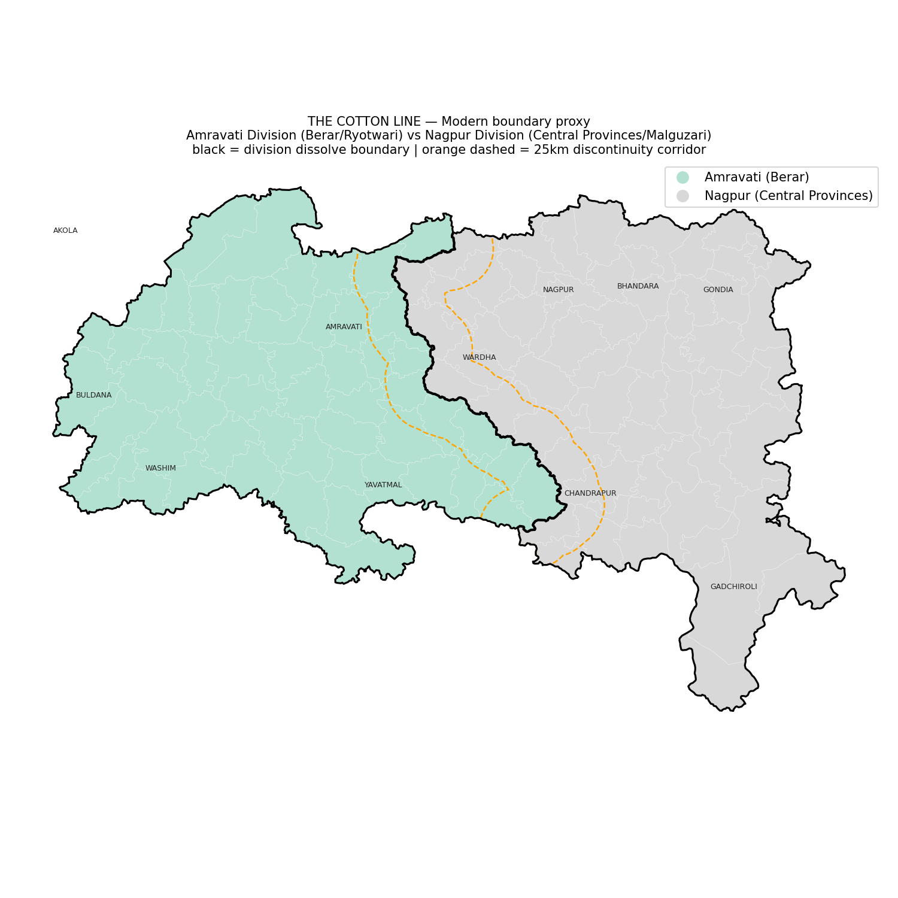

**Figure 1.** The two dissolved divisions, the 25 km discontinuity corridor over the taluka grid, and the 384.7 km boundary line. (TODO: the AKOLA label sits outside its polygon and the map has no scale bar or north arrow; fix in the source map.)

### 3.4 Outcome Variables

Four outcomes are analysed.

- **Kharif-to-rabi NDVI decline.** For each taluka, the fall in mean NDVI from a post-monsoon scene (early to mid November) to a pre-harvest scene (early March), computed from Landsat 8/9 Level-2 surface reflectance (SR_B4 red, SR_B5 near-infrared). Year one uses scenes from 8 November 2025 and 8 March 2026; year two, used as a replication, uses scenes from 13 November 2024 (row 045) and 5 November 2024 (row 046), and 5 March 2025. Each window uses the single lowest-cloud scene (scene cloud cover below 60%).
- **Land surface temperature (LST).** Mean June 2026 surface temperature from the Landsat thermal band (ST_B10), single date.
- **Agrarian labour ratio.** Agricultural labourers (main and marginal) divided by cultivators, from Census village data aggregated to the taluka.
- **Net cultivated area (%).** Net sown area share of reported village area, from the same source. Land-use categories (forest, non-agricultural use, barren, permanent pasture, miscellaneous tree crops, cultivable waste, current and other fallow, net sown) were checked for internal consistency before use.

A pipeline bug was found and fixed before any results were relied on. Landsat Collection 2 Level-2 products use digital number (DN) = 0 as a fill value for off-swath pixels, about one-third of each scene. An earlier processing step applied the scale and offset directly to raw DN without masking DN = 0. The broken thermal output showed exactly 149 K (−124.15 °C) wherever DN = 0, and the same bug affected the reflectance pipeline, where the merged raster reported 100% valid pixels while the source fill rate was about 33%. All rasters were reprocessed after setting DN = 0 to no-data before scaling.

DN = 0 marks off-swath fill, not clouds. No cloud or cloud-shadow mask based on the QA_PIXEL band has been applied, and the scene selection relies on low scene-level cloud cover only. This is a limitation (Section 6.8).

### 3.5 Spatial-Discontinuity Regression

Each outcome is estimated by ordinary least squares:

outcome ~ side + signed_dist_km + side×signed_dist_km + annual_total_mm + elevation_m

Two coefficients carry the questions. `side` is an indicator for Berar (Ryotwari) and tests for a level difference at the boundary. `side×signed_dist_km` tests whether the outcome changes differently with distance on the two sides. `signed_dist_km` is the taluka-centroid distance to the dissolved boundary, measured in UTM zone 44N, positive on the Berar side. Rainfall and elevation are controls. Each outcome was estimated on the 32-taluka corridor and on the 66–68-taluka full footprint (the count depends on which variables the footprint supports).

Elevation is from SRTM 1 arc-second tiles sampled at taluka centroids (194–497 m in the corridor). Rainfall is WorldClim 2.1 annual precipitation sampled at centroids. Both are long-term normals, and the ~18.5 km rainfall grid is coarser than most talukas.

### 3.6 Robustness Checks and Scope Decisions

A leave-one-out jackknife (32 refits, one corridor taluka dropped each time) was applied to the significant corridor interaction. The full-footprint extension is a second scale check. Section 4.4 adds heteroskedasticity-robust (HC3) and district-clustered standard errors, multiple-testing correction, symmetric distance windows, placebo cutoffs, influence diagnostics, and a valid-pixel coverage test, all reproducible with `05_Python/robustness_checks.py`.

Two variables were left out of the regression. The Census irrigation field (area_irri over net_area) reports 58–92% irrigated in sampled villages, far above the roughly 15–20% documented for the Vidarbha cotton belt. Its units are unclear, so it is not used, and it is not reported as a number. (TODO: the column `irrigation_pct` is still present in `taluka_population_agri_stats.csv`; drop it or mark it as unreliable in the file.) Forest Rights Act (FRA) claims and titles have no consistent public taluka-level series for Vidarbha. Figures from the state administrative report, the 2024 fact-finding committee, one Gadchiroli taluka, the Vidarbha regional total, and village case studies are compiled as a sourced table, with scope, value, unit, as-of date and source for each figure, and used only as context in the institutional-history discussion.

## 4. Results

### 4.1 Cotton-Signature NDVI: A Regional Gradient, Nearly Absent in the Corridor

On the full footprint (68 talukas) the mean NDVI decline is 0.325 on the Berar side and 0.255 on the Central Provinces side, a raw difference of 0.070 (about 1.08 standard deviations; Welch t = 5.4). The spread differs too: the Central Provinces side has the larger standard deviation (0.062 vs 0.041), which is consistent with a mix of single- and double-crop areas there. Post-monsoon NDVI is almost identical on both sides (Berar 0.66, Central Provinces 0.64), so the difference is in what happens after November, not in monsoon greenness.

In year two (64 of 68 talukas with valid data in both years), the gap is 0.316 (Berar) against 0.241 (Central Provinces), a difference of 0.075. Because both years use the same footprint, method and seasonal windows, the second year replicates a regional gradient under different weather. It is not an independent test of a boundary effect.

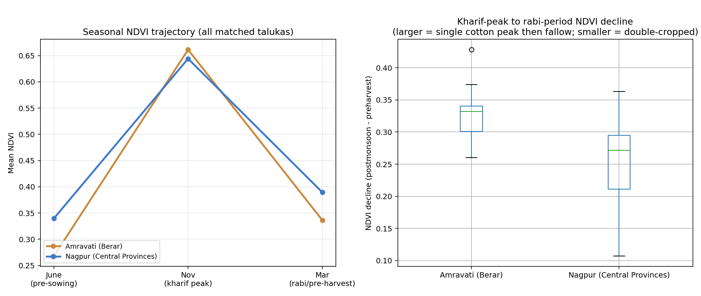

**Figure 2.** Seasonal NDVI trajectory (post-monsoon to pre-harvest) and the kharif-to-rabi reduction, by division, year one.

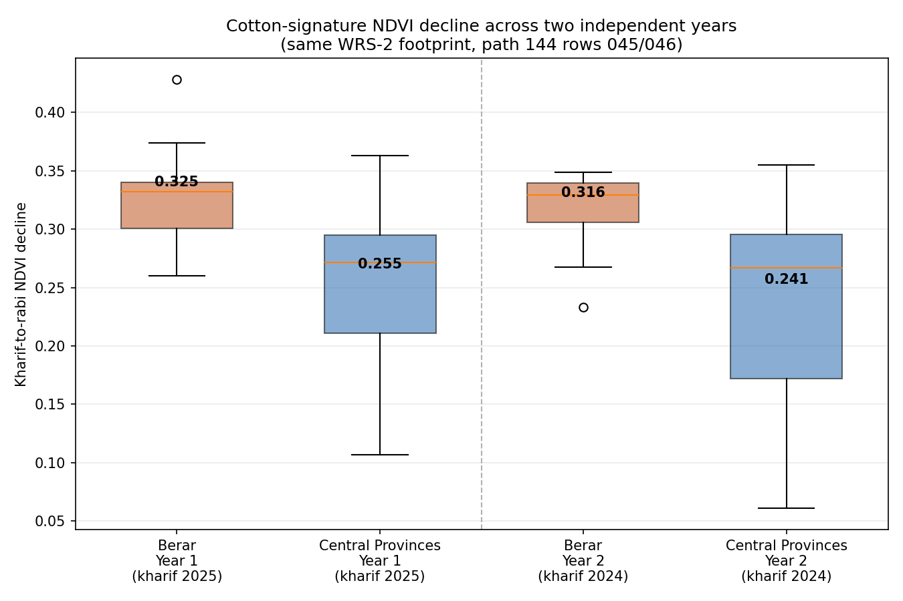

**Figure 3.** The kharif-to-rabi NDVI reduction in the second annual cycle, by division.

In the 25 km corridor the gap almost disappears: 0.310 (Berar) against 0.299 (Central Provinces) across 29 talukas. The Central Provinces corridor talukas (Wardha, Nagpur, Chandrapur) are also major cotton producers, so near the line the two sides look alike. The regional NDVI difference is therefore not concentrated at the boundary. Section 4.3 shows that, once distance is in the model, the `side` coefficient is close to zero.

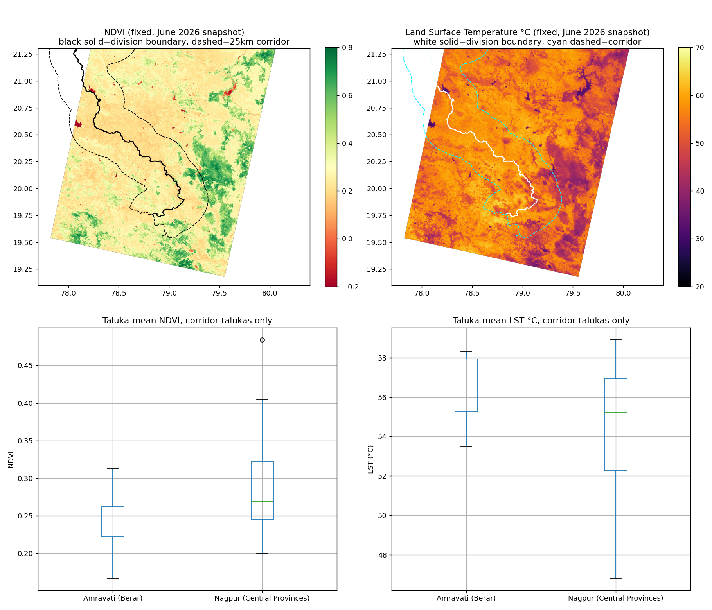

**Figure 4.** NDVI and land-surface-temperature maps and division boxplots, June 2026 single-date snapshot, corridor.

### 4.2 Agrarian Labour Structure, Land Use, and Cotton Dependency

The agricultural-labourer-to-cultivator ratio is 2.90 in Berar and 1.96 on the Central Provinces side across the 32 corridor talukas (15 Berar, 17 Central Provinces). Section 4.4 shows that the corridor interaction for this outcome depends on one urban taluka.

Net cultivated area is higher on the Berar side (68.9% vs 61.5%). Forest cover is almost the same on both sides (12.5% vs 12.6%), because the corridor runs through a shared farming area and the Central Provinces' larger forests lie further east in Gadchiroli, outside it. Fallow land is 5.8% on the Central Provinces side against 3.3% in Berar. Fallow can reflect ordinary crop rotation and is not read here as economic distress.

District-level cotton shares do not split along the old line. Yavatmal (Berar; 51% of farmland under cotton) and Wardha (Central Provinces; 49%) are nearly tied, followed by Chandrapur (38%) and Nagpur (38%). Bhandara (0.15%) and Gondia (0%) are far lower, but that reflects rice cultivation. Cotton did not stay within the old line, and Wardha has a long cotton history of its own.

The spread of net sown area is wider across the six Nagpur Division districts (standard deviation 15.4) than across the five Amravati Division districts (60–75%, standard deviation 6.8). This is a comparison of 6 and 5 district values with no formal test, and it is descriptive only. It is compatible with a Central Provinces that combines heavily cultivated and heavily forested districts, but it is not evidence of a tenure effect.

Mean holding size shows no meaningful corridor difference: 1.81 ha in Berar and 1.90 ha in the Central Provinces. This is a district-level value repeated across talukas.

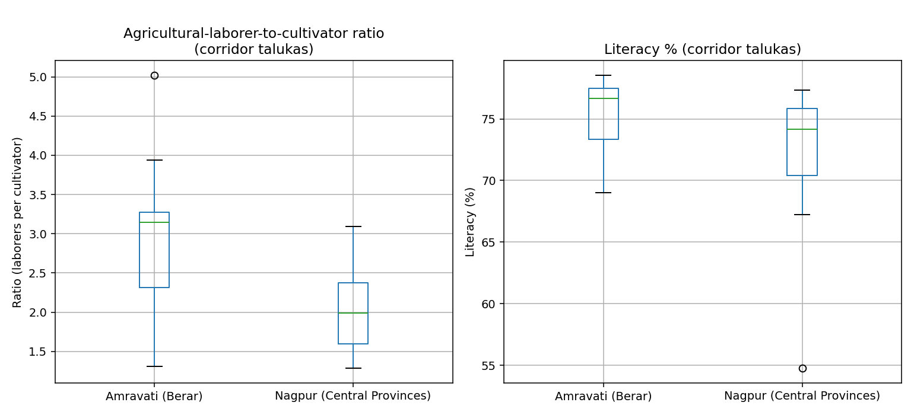

**Figure 5.** Agricultural-laborer-to-cultivator ratio and literacy, by division, corridor talukas.

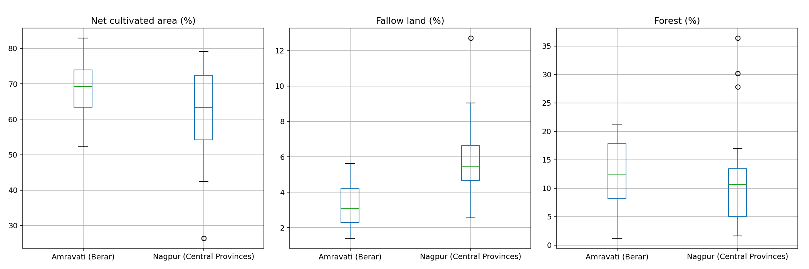

**Figure 6.** Net cultivated area, fallow land, and forest cover, by division, corridor talukas.

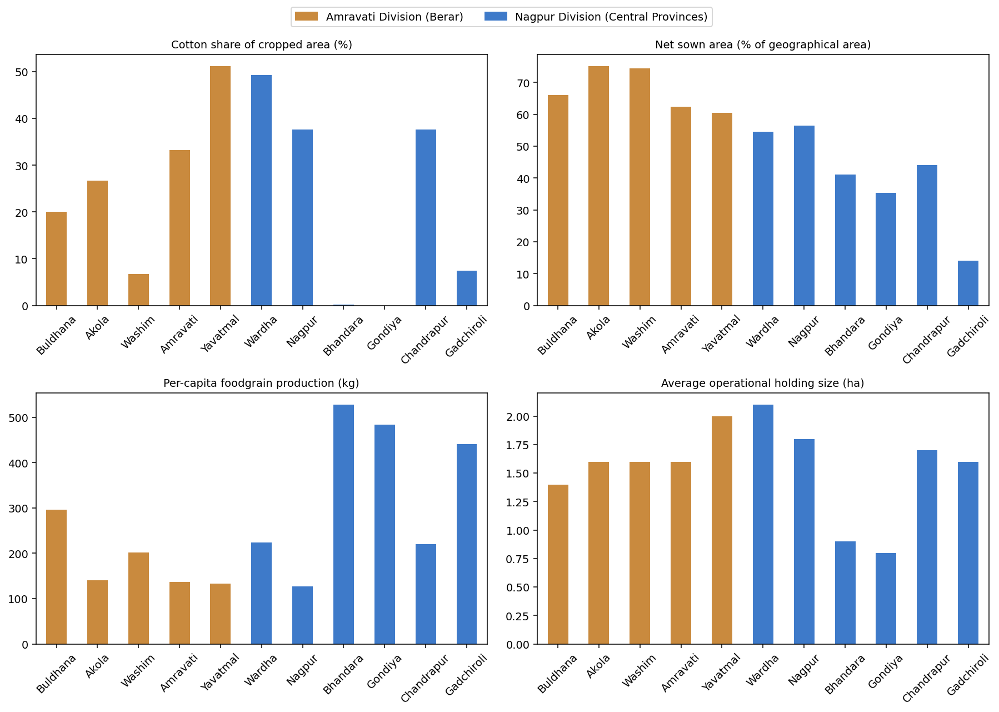

**Figure 7.** Cotton share, net sown area, per-capita foodgrain production, and average holding size, by district (11 districts).

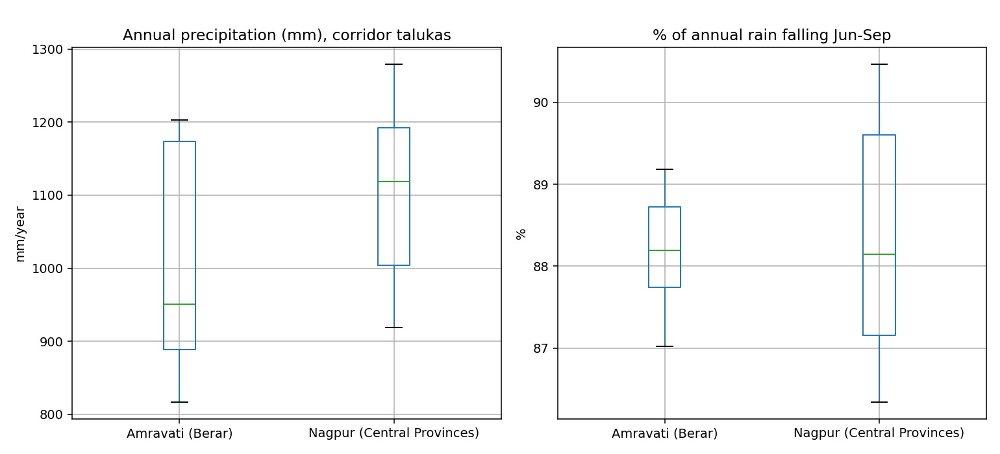

**Figure 8.** Annual precipitation total and monsoon-season share, by division, district-wide and corridor.

### 4.3 Spatial-Discontinuity Regression: Level Jump and Slope Difference

Controls behave as expected. In the NDVI-decline model rainfall has p = 0.015 and elevation p = 0.002. In the labour-ratio model rainfall has p < 0.001 and elevation p = 0.291. In the net-area model rainfall has p = 0.046 and elevation p = 0.020. Vidarbha's dry-west, wet-east geography moves these outcomes, and the controls pick it up.

**Corridor scale (32 talukas).** None of the four outcomes shows a significant `side` term: NDVI decline p = 0.458, labour ratio p = 0.960, net cultivated area p = 0.577, LST p = 0.792.

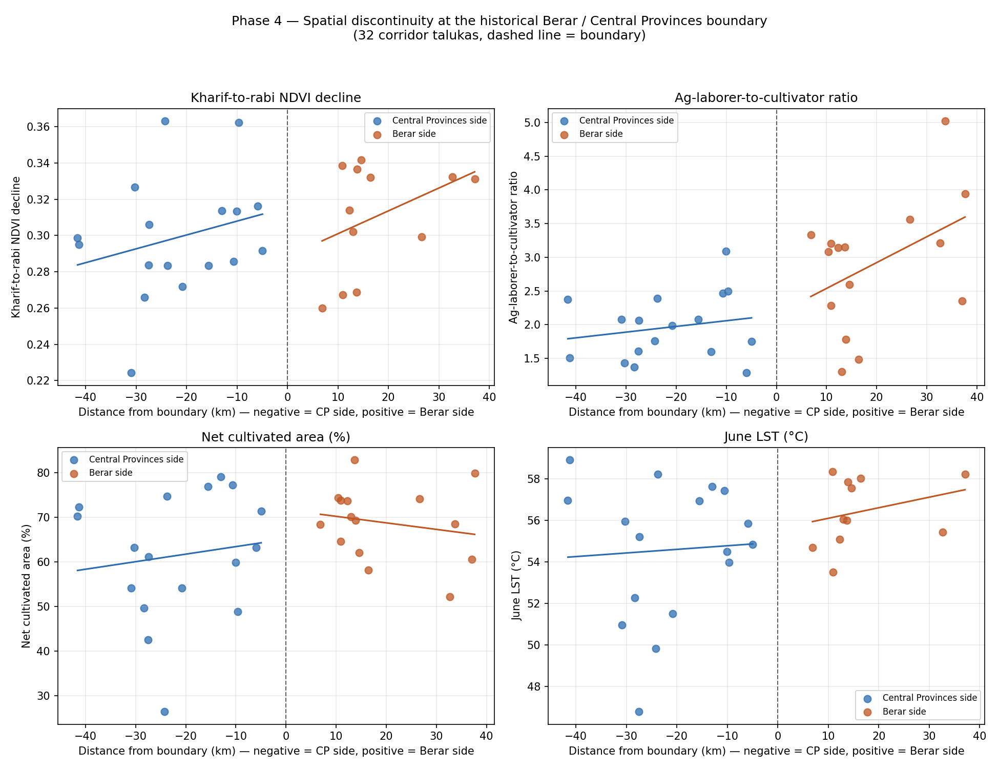

**Figure 9.** Each outcome against distance to the boundary with per-side fitted lines, corridor scale, four headline outcomes. (The plotted lines are per-side fits without the rainfall and elevation controls, so they are illustrative and differ from the controlled model.)

One corridor result stands out: the `side×signed_dist_km` interaction for the labour ratio is 0.0374 (p = 0.0361). Under the leave-one-out jackknife the coefficient keeps its direction and rough size, but the p-value moves between 0.015 and 0.138 depending on which taluka is dropped (for example Amravati taluka, Seloo, Samudrapur, Narkhed, Korpana, Yavatmal taluka), and stays below 0.05 in 26 of 32 runs. Section 4.4 shows that dropping Amravati (an urban taluka with a labour ratio of about 5) alone raises the p-value to 0.138, and that HC3 standard errors give p = 0.063.

**Full-footprint scale (66–68 talukas).** For NDVI decline and LST, the `side` term is again not significant (NDVI p = 0.821, LST p = 0.512). In these models the side-by-distance interaction is significant: NDVI decline p = 0.0348 and LST p = 0.0105. In both models the main `signed_dist_km` term is also highly significant (p < 0.001). The two sides thus follow different trends away from the boundary, without a step at it.

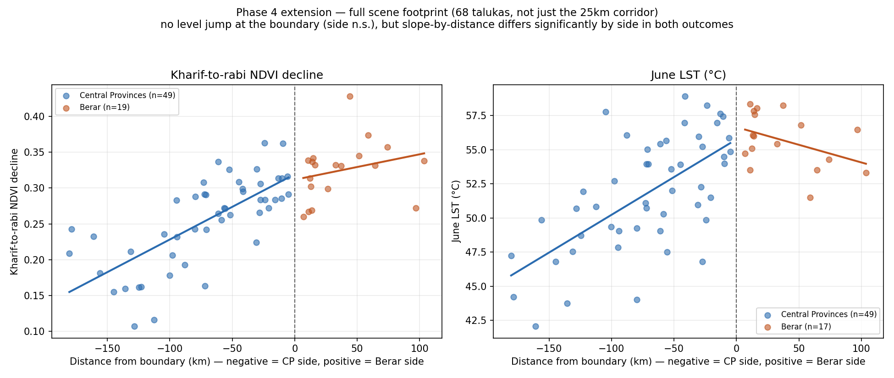

**Figure 10.** NDVI decline and LST against distance to the boundary, full footprint. (Per-side fits without rainfall and elevation controls; illustrative.)

The two channels do not show the same shape. For NDVI decline the slope against signed distance is positive on both sides (about 0.0010 per km on the Central Provinces side and 0.0002 per km on the Berar side), which is a west-to-east decline that flattens on the Berar side. For LST the slopes have opposite signs (+0.046 °C per km on the Central Provinces side and −0.026 °C per km on the Berar side, in signed distance), so LST is lower with distance from the boundary on both sides and peaks near the line. The earlier draft described the two channels as showing the same trend; that is not correct.

**Labour ratio at full-footprint scale.** For the labour ratio the level-jump term is significant at the full footprint (`side` coefficient 0.622, p = 0.014), while the interaction is not (p = 0.579). At the corridor scale the pattern is the reverse: `side` p = 0.960 and interaction p = 0.036. So the labour ratio is significant on different terms at different scales, and its level difference across the boundary is scale-dependent.

The earlier draft explained this as an artefact of a lopsided footprint, but I did not test that explanation. Section 4.4 now does, using symmetric windows in which the Berar and Central Provinces sides span comparable distances. The level term stays significant (p = 0.004 within 105 km, p = 0.008 within 80 km, p = 0.041 within 60 km), so a lopsided footprint does not by itself explain the result. The finding is therefore the most persistent boundary-type result in the paper, with two limits: it is absent in the corridor, and it does not hold under district-clustered errors (p = 0.11), although clustering is unreliable here because the Berar side contains only two districts (Amravati and Yavatmal) in the census-based sample. "Berar" in this outcome is effectively those two districts. Net cultivated area shows no significant `side` or interaction term at either scale (corridor `side` p = 0.577, full footprint p = 0.121).

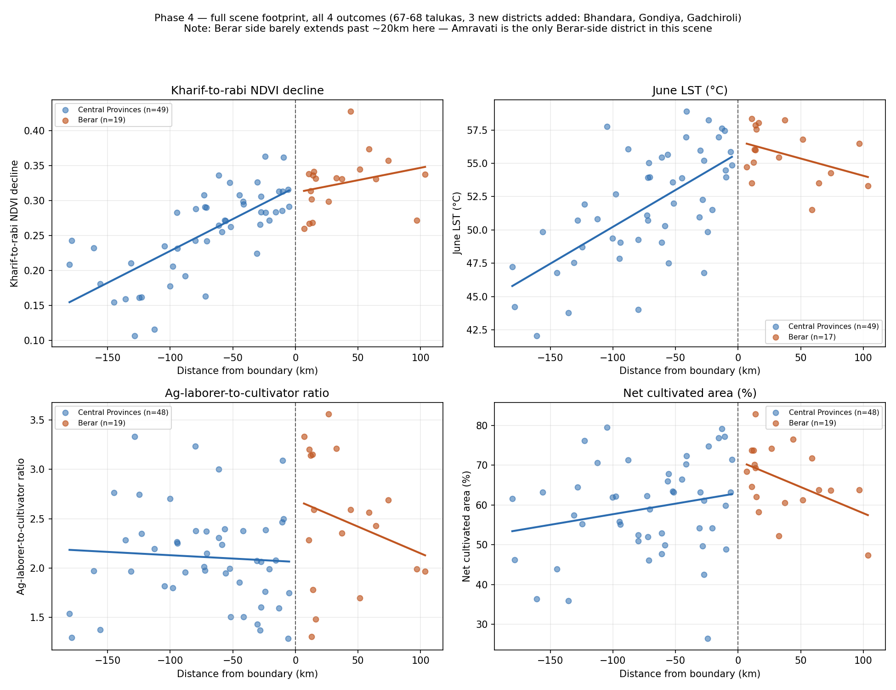

**Figure 11.** All four full-footprint outcomes (NDVI decline, LST, labour ratio, net cultivated area) against distance to the boundary, per-side fits. (The title in the image lists Gadchiroli among the districts added; it contributes no talukas to the census-based samples. Regenerate the figure with a corrected title.)

### 4.4 Robustness and Multiple Testing

All results in this section come from `05_Python/robustness_checks.py`, which writes CSVs to `03_Data_Processed/Phase4/robustness/`.

**Multiple testing.** Sixteen coefficients were tested (the `side` and interaction terms for four outcomes at two scales). Four have raw p < 0.05 where chance alone would give about 0.8. After Holm correction none survives, and the smallest Benjamini–Hochberg q-value is 0.115 (shared by the LST interaction and the full-footprint labour-ratio level term). The four raw-significant results should be read as exploratory.

| Test | Scale | Raw p | HC3 p | Holm p | BH q |
|---|---|---|---|---|---|
| NDVI decline, side×distance | Full | 0.0348 | 0.0799 | 0.487 | 0.144 |
| LST, side×distance | Full | 0.0105 | 0.0030 | 0.168 | 0.115 |
| Labour ratio, side×distance | Corridor | 0.0361 | 0.0628 | 0.487 | 0.144 |
| Labour ratio, side (level) | Full | 0.0144 | 0.0321 | 0.215 | 0.115 |

The full set of 16 tests, with district-clustered p-values, is in `main_models_with_corrections.csv`. District clustering is shown there but not relied on: it has 5 (corridor) or 7 (full footprint) clusters, and the corridor labour interaction gives an implausible clustered p of 0.00004.

**NDVI interaction.** It is fragile. HC3 p = 0.080, district-clustered p = 0.073, and dropping the most influential taluka (Mahagaon, Cook's D 0.21) raises p to 0.27. In symmetric windows it is p = 0.037 (120 km), 0.060 (105 km), 0.438 (80 km) and 0.071 (60 km).

**LST interaction.** It is the most robust result: HC3 p = 0.003, district-clustered p = 0.003, and it holds in symmetric windows (p = 0.036 at 120 km, 0.037 at 105 km, 0.012 at 80 km, 0.082 at 60 km) and after dropping the most influential taluka (p = 0.005). It is still a single June date whose shape is a ridge at the boundary, not a step.

**Placebo cutoffs.** Within the Central Provinces side alone, where there is no historical boundary, placing a fake cutoff at −100 km or −80 km produces "jumps" in NDVI decline (p < 0.001 and p = 0.001). The data are shaped by a non-linear agro-ecological gradient in the east (irrigated, paddy-growing Bhandara and Gondia), and a linear-in-distance model is a poor description of it. This weakens any reading of the NDVI interaction as a boundary effect.

**Collinearity.** Signed distance correlates at −0.74 with rainfall and 0.74 with the side indicator; rainfall and elevation explain 57% of the variance in signed distance. The distance and rainfall coefficients are therefore not well separated.

**Valid-pixel coverage.** In the full footprint, 63% of talukas have less than 50% valid Landsat pixels, some far less (Digras 0.03%, Goregaon 0.1%, Darwha 0.7%). Restricting to at least 25% valid coverage (n = 55) leaves the NDVI (p = 0.031) and LST (p = 0.022) interactions significant. Restricting to at least 50% (n = 23, 6 Berar) leaves nothing significant, though power is very low.

**Corridor labour ratio.** Dropping the urban Amravati taluka raises the interaction p-value from 0.036 to 0.138.

## 5. Discussion

The main result is that no outcome shows a boundary-specific step in the primary NDVI, LST or net-area specifications, at the corridor or the full-footprint scale. The one exception, the labour-ratio level difference at the full footprint, is scale-dependent and rests on two Berar districts. A null at the exact line is a substantive result, and reporting a jump where the data do not show one would be worse.

The data do show a regional gradient. The kharif-to-rabi NDVI decline is larger on the Berar side in both years (0.070 and 0.075), and near the boundary the two sides are much closer (0.310 vs 0.299). The side×distance interaction is significant on the full footprint for LST and for NDVI decline, but the two do not show the same shape (Section 4.3), only LST is robust to alternative standard errors and windows, and neither survives correction for the number of tests. The raw Berar–Central Provinces NDVI gap is regional: once distance is controlled the `side` coefficient is close to zero, and placebo cutoffs on the Central Provinces side alone produce comparable "jumps".

What this does not show is that the Ryotwari/Malguzari distinction caused any of these patterns. The boundary coincides with at least four other differences: the pre-1853 frontier between the Nizam's Berar and the Bhonsle territory, the Wardha River, a rainfall and soil gradient (black cotton soils in Berar, mixed soils and paddy in the east), and different irrigation and forest cover. Iversen et al.'s (2013) recoding of Malguzari as a system with real tenant protection is consistent with a graded, non-sharp legacy, but a graded pattern also fits ordinary regional agro-ecology, and the present design cannot separate the two.

In the corridor, the labour-ratio interaction (p = 0.036) is not robust to HC3 errors (p = 0.063) or to dropping Amravati taluka (p = 0.138). At the full footprint the labour-ratio level difference (p = 0.014) is more persistent but is not replicated in the corridor. I therefore do not rank one scale above the other, as the earlier draft did.

Given these limits, the fair summary is that the analysis finds a regional gradient in cropping-intensity and surface temperature that partly coincides with the old boundary, and a level difference in labour structure at one scale, with no clean evidence of a discontinuity at the line. Whether that pattern reflects tenure history, earlier political geography, or physical geography remains open.

## 6. Limitations

### 6.1 Sample Size and Power at the Corridor Scale

The 32-taluka corridor can detect only a large, sharp jump. Under the leave-one-out jackknife the directions of the estimates are stable but the p-values move widely, which is what a sample this size predicts.

### 6.2 Rainfall as a Long-Term Climatology

WorldClim rainfall is a multi-decade average on a grid of roughly 18.5 km, coarser than most talukas. It is a first-order control for regional rainfall and does not capture interannual variation or within-taluka differences.

### 6.3 Full-Footprint Sample Asymmetry

The Landsat path and row (WRS-2 path 144, rows 045/046) fix which talukas are included regardless of where the historical provinces ended. The Berar side reaches about 104 km from the boundary, the Central Provinces side about 180 km. Only Amravati and parts of Yavatmal supply Berar-side census data, so Akola, Buldhana and Washim are never part of the census-based analysis. Symmetric-window checks (Section 4.4) reduce but do not remove this problem.

### 6.4 Spatial Autocorrelation and Standard Errors

Neighbouring talukas are spatially correlated, so conventional standard errors overstate precision (Kelly, 2019, 2025). The paper reports HC3 and district-clustered errors, but district clustering is unreliable with only five (corridor) or seven (full footprint) clusters in total, and it does not model spatial dependence. Conley spatial-HAC errors or a spatial-block bootstrap are the appropriate next step (TODO).

### 6.5 Confounders Not Controlled

Soil type, irrigation, forest cover, urbanisation and crop mix are not in the model. Two villages 9 km apart in the ground-truth check (Sawardoh and Karanja) differ in soil (reddish soil vs black cotton soil). Irrigation was dropped because the Census field is unreliable (Section 3.6). The Berar-side census sample is effectively two districts, and the labour ratio is sensitive to one urban taluka.

### 6.6 Ground-Truth Check: Illustrative Only, Central Provinces Side

The ground-truth check uses seven field boundaries in Karanja Ghadge and Sawardoh villages of Wardha district, 15.6–24.3 km from the boundary on the Central Provinces side. Data are from a separate family field-monitoring project ("Roots & Reflectance") that already tracked these fields with GPS coordinates and dated photos. It is not a validation of the main results, for four reasons.

1. It measures a different quantity in a different season. The field data are Sentinel-2 NDVI and NDRE at 10 m for 21 June 2026 (just before sowing, which took place on 22–27 June) and 14 July 2026 (about three weeks after sowing). The main analysis uses the Landsat 30 m NDVI decline from November to March. NDVI of 0.28–0.36 on 14 July reflects a young canopy and should not be read as closed-canopy cover, which would be much higher.
2. It covers one side of the boundary only, so it cannot validate a Berar–Central Provinces difference.
3. The timing is loose. Ground photos are dated 23 August and the NDVI observations 14 July; the 21 June Sentinel-2 value is missing for the Karanja fields (cloud), and the taluka-level Landsat NDVI/LST in this area has only 45.8% valid pixels because Karanja Ghadge sits at the edge of the scene footprint.
4. No quantitative comparison between the two products is reported.

The check shows that the field sites, crops and satellite-derived greenness are plausible and mutually consistent for a young kharif canopy on the Central Provinces side. It should be described as an illustrative field check. All seven fields are included in the dataset (`karanja_sawardoh_field_ground_truth.csv`); the dashboard page previously featured only four. A validation of the main NDVI decline would need fields on both sides of the boundary, observed in the same seasons as the Landsat scenes.

### 6.7 A Historical-Lineage Verification, Not a Literal Map Overlay

No digitisable period map was found (the best available is from about 1903), so the historical accuracy of the boundary rests on documented district lineage for 1903–1956. This does not rule out taluka-level transfers, and Section 3.3 notes that some Central Provinces-side talukas came from other jurisdictions. A digitised historical map would strengthen the verification.

### 6.8 Cloud Masking, Single-Date Scenes, and Coverage

Scenes are selected by low scene-level cloud cover, and no QA_PIXEL cloud or shadow mask is applied. NDVI rasters contain negative values down to −0.986, which suggests water, shadow or cloud contamination. Each seasonal window contributes one scene, and LST is a single pre-monsoon June date. Partial-coverage talukas enter the regressions with full weight. Section 4.4 shows that the NDVI and LST interactions survive a 25% coverage threshold but not a 50% threshold.

### 6.9 Data Vintage and Level Mismatch

Census attributes date from 2011 and are compared with 2024–26 satellite data. Cotton share and holding size are district-level values, so they reflect district differences and not taluka variation.

### 6.10 FRA Data as Narrative, Not Quantitative Evidence

There is no consistent public taluka-level series on Forest Rights Act claims and titles for Vidarbha. The figures in Section 3.6 come from incompatible scales and dates, are excluded from the statistical tests, and serve as institutional-history context.

## 7. Future Work

1. **Symmetric geometry.** Use additional Landsat scenes so that all 11 districts are covered, giving comparable distance ranges on both sides of the boundary.
2. **Full census coverage.** Extend the population and land-use data from 8 to all 11 districts (Akola, Buldhana and Washim are missing); this would allow the labour-ratio and land-use tests to be run region-wide.
3. **Spatial inference.** Report Conley spatial-HAC or block-bootstrap standard errors, and test flexible functional forms in distance (quadratic or spline) and rainfall.
4. **Cloud masking and multiple dates.** Apply QA_PIXEL masking and use several scenes per season or a Sentinel-2 time series.
5. **Boundary history.** Digitise a period map from the Imperial Gazetteer or the Central Provinces and Berar atlas, and test the exclusion of Hyderabad- and Madras-origin talukas (Rajura, Korpana, Jiwati and others).
6. **Two-sided field validation.** Collect field observations on both sides of the boundary in the same season as the satellite scenes.

## 8. Conclusion

Berar was assigned to the East India Company in 1853 and merged with the Central Provinces in 1903, and district lineage from 1903 to 1956 indicates that the present Amravati/Nagpur Division line matches the old Berar/Central Provinces line at district level. Across a 32-taluka corridor and a 68-taluka Landsat footprint, and after controlling for distance, rainfall and elevation, I find no boundary-specific step in kharif-to-rabi NDVI decline, LST or net cultivated area. The labour-ratio level difference on the full footprint is the one exception, and it is present at one scale and absent at the other.

The data do show a regional gradient in cropping-intensity and surface temperature. On the full footprint, the side-by-distance interaction is significant for NDVI decline and for LST. Only the LST interaction is robust to alternative standard errors and windows, none of the 16 tests survives Holm correction, and placebo cutoffs on the Central Provinces side alone produce comparable patterns. The NDVI gap between Berar and the Central Provinces is regional, not boundary-specific.

The honest conclusion is that a regional agrarian gradient coincides with the old Berar/Central Provinces line, but this analysis cannot attribute it to Ryotwari or Malguzari tenure. The boundary is also an older political frontier, a river line and an agro-ecological transition, and the design has limited power to separate those explanations. The paper's value lies in a reproducible boundary construction, a documented data pipeline including the DN = 0 fix, and a transparent account of what the tests do and do not support. The field check at Karanja Ghadge and Sawardoh is illustrative only and does not validate the main result.

## References

Baden-Powell, B. H. (1892). *The Land-Systems of British India: Being a Manual of the Land-Tenures and of the Systems of Land-Revenue Administration Prevalent in the Several Provinces* (3 vols.). Oxford: Clarendon Press.

Banerjee, A. V., & Iyer, L. (2005). [History, institutions, and economic performance: The legacy of colonial land tenure systems in India](https://www.aeaweb.org/articles?id=10.1257/0002828054825574). *American Economic Review*, 95(4), 1190–1213.

Beckert, S. (2014). *[Empire of Cotton: A Global History](https://www.penguinrandomhouse.com/books/10461/empire-of-cotton-by-sven-beckert/)*. Knopf.

Conley, T. G. (1999). GMM estimation with cross sectional dependence. *Journal of Econometrics*, 92(1), 1–45. (TODO(verify): add DOI.)

Dell, M. (2010). [The persistent effects of Peru's mining mita](https://onlinelibrary.wiley.com/doi/10.3982/ECTA8121). *Econometrica*, 78(6), 1863–1903.

Dell, M., & Olken, B. A. (2020). [The development effects of the extractive colonial economy: The Dutch cultivation system in Java](https://academic.oup.com/restud/article/87/1/164/5490392). *Review of Economic Studies*, 87(1), 164–203.

Farr, T. G., Rosen, P. A., Caro, E., Crippen, R., Duren, R., Hensley, S., Kobrick, M., Paller, M., Rodriguez, E., Roth, L., Seal, D., Shaffer, S., Shimada, J., Umland, J., Werner, M., Oskin, M., Burbank, D., & Alsdorf, D. (2007). [The Shuttle Radar Topography Mission](https://agupubs.onlinelibrary.wiley.com/doi/10.1029/2005rg000183). *Reviews of Geophysics*, 45(2), RG2004.

Fick, S. E., & Hijmans, R. J. (2017). [WorldClim 2: New 1-km spatial resolution climate surfaces for global land areas](https://rmets.onlinelibrary.wiley.com/doi/10.1002/joc.5086). *International Journal of Climatology*, 37(12), 4302–4315.

Iversen, V., Palmer-Jones, R., & Sen, K. (2013). [On the colonial origins of agricultural development in India: A re-examination of Banerjee and Iyer, "History, institutions and economic performance"](https://www.tandfonline.com/doi/abs/10.1080/00220388.2013.807502). *Journal of Development Studies*, 49(12), 1631–1646.

Iyer, L. (2010). [Direct versus indirect colonial rule in India: Long-term consequences](https://direct.mit.edu/rest/article/92/4/693/57986). *Review of Economics and Statistics*, 92(4), 693–713.

Keele, L. J., & Titiunik, R. (2015). [Geographic boundaries as regression discontinuities](https://www.cambridge.org/core/journals/political-analysis/article/geographic-boundaries-as-regression-discontinuities/2A59F3077F49AD2B908B531F6E458430). *Political Analysis*, 23(1), 127–155.

Kelly, M. (2019, 2025). The standard errors of persistence. Working paper (2019); published in *Journal of International Economics*, 153 (2025). (TODO(verify): confirm the final publication details.)

Lee, D. S., & Lemieux, T. (2010). Regression discontinuity designs in economics. *Journal of Economic Literature*, 48(2), 281–355. (TODO(verify): add DOI.)

Maharashtra State Tribal Development Department. (2021). *[Administrative Report 2020-21](https://tribal.maharashtra.gov.in/Site/Upload/GR/Administrative%20Report%2020-21%20Final%2017092024.pdf)*. Government of Maharashtra. [Forest Rights Act compilation, Section 3.6]

Michalopoulos, S., & Papaioannou, E. (2016). [The long-run effects of the scramble for Africa](https://www.aeaweb.org/articles?id=10.1257/aer.20131311). *American Economic Review*, 106(7), 1802–1848.

Mishra, S. (2006). [Farmers' suicides in Maharashtra](https://www.epw.in/journal/2006/16/special-articles/farmers-suicides-maharashtra.html). *Economic and Political Weekly*, 41(16), 1538–1545.

Mohanty, B. B. (2005). ['We are like the living dead': Farmer suicides in Maharashtra, western India](https://www.tandfonline.com/doi/abs/10.1080/0306615042000322935). *The Journal of Peasant Studies*, 32(2), 243–276.

Roy, T. (2011). *The Economic History of India, 1857–1947* (3rd ed.). New Delhi: Oxford University Press.

Satya, L. D. (1997). Cotton and famine in Berar, 1850–1900. *Indian Economic and Social History Review*, 34(1). (TODO(verify): confirm volume, pages and DOI before citing in the text.)

Tucker, C. J. (1979). [Red and photographic infrared linear combinations for monitoring vegetation](https://www.sciencedirect.com/science/article/abs/pii/0034425779900130). *Remote Sensing of Environment*, 8(2), 127–150.

U.S. Geological Survey. *[Landsat 8-9 OLI/TIRS Collection 2 Level-2 Science Products](https://www.usgs.gov/centers/eros/science/usgs-eros-archive-landsat-archives-landsat-8-9-olitirs-collection-2-level-2)*. Earth Resources Observation and Science (EROS) Center.

Government of Maharashtra. (2026). *[Economic Survey of Maharashtra 2025-26](https://mahades.maharashtra.gov.in/home.do?lang=en)*, Chapter 7 (Agriculture). Commissionerate of Agriculture.

Government of Maharashtra. (1994, April 30). *[The Development Boards for Vidarbha, Marathwada and the Rest of Maharashtra Order, 1994](https://indiankanoon.org/doc/11824594/)*, Notification No. GS/G/94/DB/432, issued under Article 371(2) of the Constitution of India.
